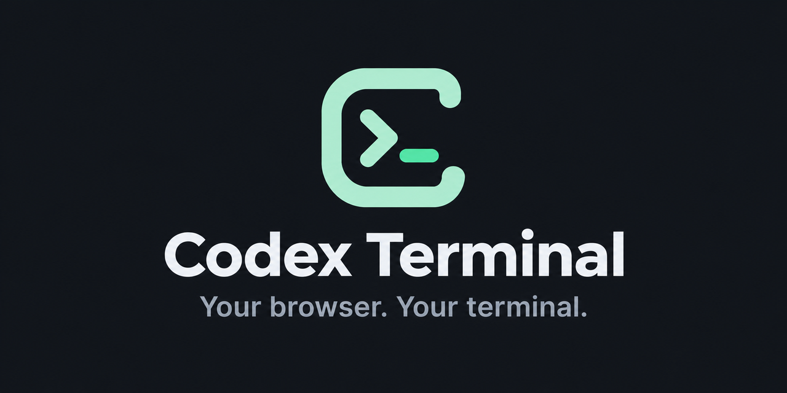

<p align="center">
  
</p>

# Codex Terminal

A compact Debian Bookworm Slim-based container with Codex CLI, ttyd, tmux, Git, and Node.js. No desktop required. The browser UI is exposed on port 7681. The terminal automatically fits the browser viewport, using a 10px font below 768px viewport width and 16px on larger screens, with a line height of 1.2. The mobile size approximates the apparent text size before device-width viewport fitting was introduced. It refits when the window resizes, the phone rotates, or the mobile keyboard opens or closes; browser zoom can remain at 100%.

The Docker image is available at `ghcr.io/dorseg/codex-terminal:latest`.

## Docker installation

1. On your Docker host, prepare persistent directories that the container's user (UID 1000) can write to:

   ```sh
   mkdir -p ./config ./projects
   sudo chown -R 1000:1000 ./config ./projects
   ```

2. Start the container from the same directory:

   ```sh
   docker run -d --name codex-terminal \
     -p 7681:7681 \
     -v "$(pwd)/projects:/workspace" \
     -v "$(pwd)/config:/home/node/.codex" \
     ghcr.io/dorseg/codex-terminal:latest
   ```

3. Open `http://DOCKER_HOST_IP:7681` on a **trusted local network** (or `http://localhost:7681` on the Docker host). To sign into Codex, run this in the browser terminal:

   ```sh
   codex login --device-auth
   ```

The terminal opens without a browser login by default. See [Optional terminal login](#optional-terminal-login) to require credentials.

## Remote access

For remote access, **configure Cloudflare Access** with an identity restriction and MFA **before** publishing a Cloudflare Tunnel route to `http://DOCKER_HOST_IP:7681`. Never forward the raw port on your router. Cloudflare Access does not protect the local published port, so restrict local access with firewall/network rules as appropriate.

## Unraid installation

1. Prepare persistent paths in Unraid Terminal:

   ```sh
   mkdir -p /mnt/user/appdata/codex-terminal/config /mnt/user/appdata/codex-terminal/projects
   chown -R 1000:1000 /mnt/user/appdata/codex-terminal/config /mnt/user/appdata/codex-terminal/projects
   ```

2. Go to **Docker → Add Container** and configure:

   | Setting | Value |
   | --- | --- |
   | Name | `codex-terminal` |
   | Repository | `ghcr.io/dorseg/codex-terminal:latest` |
   | Network | Bridge |
   | TCP port | host `7681` → container `7681` |
   | Projects path | `/mnt/user/appdata/codex-terminal/projects` → `/workspace` (RW) |
   | Codex config path | `/mnt/user/appdata/codex-terminal/config` → `/home/node/.codex` (RW) |
   | Web UI (optional) | `http://[IP]:[PORT:7681]/` |

   To enable [optional terminal login](#optional-terminal-login), add `AUTH_USERNAME` and `AUTH_PASSWORD_HASH` as two **Variable** entries in the container settings. Paste the complete generated hash literally into `AUTH_PASSWORD_HASH`.

3. Open `http://UNRAID_IP:7681` on a **trusted local network**. To sign into Codex:

   ```sh
   codex login --device-auth
   ```

4. For access outside your local network, follow the [remote access guidance](#remote-access) using your Unraid host's IP address.

## Optional terminal login

Set both environment variables to require a browser login before accessing the terminal:

| Variable | Purpose |
| --- | --- |
| `AUTH_USERNAME` | Username for the shared terminal account |
| `AUTH_PASSWORD_HASH` | Salted scrypt hash for the shared terminal account |

Generate the hash first. This command prompts twice with hidden input; the password is never passed as a command argument. Copy the complete output beginning with `scrypt$`:

```sh
docker run --rm -it ghcr.io/dorseg/codex-terminal:latest \
  node /opt/codex-terminal/hash-password.mjs
```

For Docker CLI, add both variables when creating the container. Run this from the directory containing your `config` and `projects` directories:

```sh
docker run -d --name codex-terminal -p 7681:7681 \
  -e AUTH_USERNAME='your-user' \
  -e AUTH_PASSWORD_HASH='scrypt$32768$8$3$PASTE_YOUR_SALT$PASTE_YOUR_HASH' \
  -v "$(pwd)/projects:/workspace" \
  -v "$(pwd)/config:/home/node/.codex" \
  ghcr.io/dorseg/codex-terminal:latest
```

Open the app, enter the credentials on the login page, and the terminal appears. This account is separate from `codex login`. Refreshing the page keeps the session; it expires eight hours after login or when the container restarts. Clear the site's cookies to sign out. Existing terminal connections remain open until disconnected or the container stops.

Enter your original password on the login page. The example hash above is a placeholder; replace it with the entire generated value. Keep the single quotes in shell commands so `$` characters are preserved. In a Compose YAML value, escape each `$` as `$$` to prevent interpolation.

Keep password hashes private. HTTPS is still needed to protect login traffic outside a trusted network.

`AUTH_PASSWORD` is no longer supported and causes a startup error when nonempty. To migrate, generate a hash, remove `AUTH_PASSWORD`, and set `AUTH_PASSWORD_HASH`. To change your password, generate a new hash and recreate the container; this also invalidates existing sessions.

If both variables are unset or empty, the app opens directly to the terminal. Setting only one nonempty variable prevents startup with a configuration error. Credential values are matched exactly. Five failed attempts from one address block further attempts for one minute; users behind the same reverse proxy share this limit.

Use the default container command for terminal login to work. HTTP is supported on trusted local networks; for remote access, follow the [remote access guidance](#remote-access).

## Persistence and updates

- The process runs as the unprivileged `node` user (UID 1000), not as root.
- ttyd opens or reattaches the tmux session named `main`. Browser disconnects need not stop Codex, as long as the container runs.
- Container restarts **do** terminate tmux and running Codex processes.
- Code and Codex credentials survive container recreation because they reside in mapped volumes.
- New images are published weekly and when app or build changes land on `main`. They include updates to the base image, OS packages, and Codex CLI.
- To update, pull the latest image and recreate the container with the same settings and volume mappings. Published images do **not** automatically update your running container. Update when no Codex task is running.
- Never mount the Docker socket or unrestricted host paths into this container, or run it in privileged mode.

## Development

The image uses `node:24-bookworm-slim`. ttyd is pinned to version 1.7.7 in the Dockerfile and its download is SHA-256 verified.

Run authentication and launcher tests with Node.js 24, then build the image:

```sh
node --test test/*.test.mjs
docker build -t codex-terminal:test .
```

To generate a password hash from a local checkout, run `node app/hash-password.mjs`.

GitHub Actions runs the tests before building and publishing images tagged `latest` and with the commit SHA. Builds run on pushes to `main` that change app code, tests, the Dockerfile, `.dockerignore`, or the build workflow, plus weekly and on manual dispatch. README and documentation image changes do not trigger builds.
