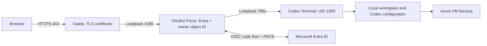

# Deploy Codex Terminal on Azure with HTTPS and Microsoft Entra ID

This guide deploys the published `ghcr.io/dorseg/codex-terminal` image on a dedicated Linux VM. Only one assigned Microsoft Entra user can reach the terminal. The example includes HTTPS, persistent storage, Codex sandbox support, daily backups, monitoring and a monthly budget alert.

You do not need to rebuild the application image or change its authentication code. The [deployment files](../infra/azure/) sit alongside the application. Use a personal or otherwise explicitly authorized Azure subscription; Azure and OpenAI charges are separate.

## What you will create



The default VM is **Standard_B1ms: 1 vCPU and 2 GiB RAM**, using Debian 12 and a 32 GiB Standard SSD. The guide also covers upgrading to Standard_B2als_v2: 2 vCPUs and 4 GiB RAM. B-series machines use CPU credits and suit light, intermittent work; sustained builds can exhaust those credits.

Most resources live in a dedicated resource group, `rg-codex-terminal`. Entra registrations are tenant objects outside any resource group. Azure Backup also creates a service-managed snapshot group such as `AzureBackupRG_northeurope_1`; the budget includes that group.

The security boundaries are:

| Boundary | Configuration |
| --- | --- |
| Public network | Only TCP 443 and TCP 80; port 80 validates certificates and redirects to HTTPS |
| Browser authentication | Single-tenant Entra registration, assignment required, only the deploying user assigned |
| Proxy authorization | Exact immutable tenant user object ID (`oid`), verified issuer/audience/signature/nonce, PKCE |
| Shell | UID 1000, all capabilities dropped, no Docker socket, no VM managed identity or Azure credentials |
| Codex commands | `workspace-write` sandbox and `on-request` approvals; tested Linux namespace support |
| Authentication secrets | Root-controlled host configuration, mounted only into the authentication proxy |
| Persistence | Local ext4 directories on the encrypted managed disk, protected by VM Backup |

Azure and tenant administrators retain control-plane access. A command you approve outside Codex's sandbox has the shell user's access, including the workspace and saved Codex credentials. This is a single-user example; sharing a workspace and saved credentials with more users requires a different isolation design.

## 1. Get the repository and local tools

Open [dorseg/codex-terminal](https://github.com/dorseg/codex-terminal), choose **Fork**, select your GitHub account and create the fork. Clone the repository and branch containing this guide using your fork's URL:

```sh
git clone https://github.com/YOUR_GITHUB_USERNAME/codex-terminal.git
cd codex-terminal
# If the guide is on a contribution branch, switch to that branch now.
```

On your administrator computer, install:

- [Azure CLI](https://learn.microsoft.com/en-us/cli/azure/install-azure-cli) with Bicep support.
- Python 3.11 or newer; the controller uses the standard library only.
- OpenSSH's `ssh-keygen`, used to create an administrator key. Public SSH remains blocked.
- Git. Node.js 24 or newer is needed only for the repository's application tests.

Check the tools:

```sh
az version
az bicep version
python3 --version
command -v ssh-keygen
```

Run all following commands from the repository root, in Bash or Zsh. You do not need a local Docker daemon to deploy.

## 2. Identify the intended Azure account, subscription and region

You need an Azure subscription with permission to create the VM, networking, backup vault, monitoring resources and a subscription-level budget. Provider registration may need subscription Owner permissions. Separately, you need Entra permission to create an application/service principal and assign the owner to the enterprise application; a tenant administrator may need to perform or authorize that setup. Azure subscription ownership does not grant Entra directory roles.

Find the **Directory (tenant) ID** and **Subscription ID** in Azure Portal → Subscriptions. Sign into that tenant and inspect the exact subscription without changing the CLI's default:

```sh
terminal_tenant='YOUR-TENANT-ID'
terminal_subscription='YOUR-SUBSCRIPTION-ID'
terminal_region='northeurope'

az login --tenant "$terminal_tenant"
az account show --subscription "$terminal_subscription" \
  --query '{subscription:name,id:id,tenant:tenantId,user:user.name}' -o json
```

Confirm that the subscription, tenant and user are yours. Put the printed `user` value in `userEmail` later; a guest user's directory UPN can differ from their sign-in email.

Check regional eligibility, size restrictions and vCPU quota before provisioning:

```sh
az vm list-skus --location "$terminal_region" --size Standard_B1ms --all \
  --subscription "$terminal_subscription" \
  --query '[].{size:name,restrictions:restrictions}' -o json
az vm list-usage --location "$terminal_region" \
  --subscription "$terminal_subscription" -o table
```

The example defaults to North Europe; subscriptions can have different regional restrictions. Use an eligible region and sufficient B-series quota. Also check the pinned Debian image version in [`main.bicep`](../infra/azure/vm/main.bicep). If unavailable in your region, list available versions and set `imageVersion` in your private configuration to a reviewed version:

```sh
az vm image list --location "$terminal_region" --publisher Debian \
  --offer debian-12 --sku 12-gen2 --all \
  --subscription "$terminal_subscription" \
  --query '[].{version:version,urn:urn}' -o table
```

All controller calls explicitly select the configured subscription. Microsoft Graph tokens also come from that subscription's tenant, and the controller rejects mismatched tenant IDs. This matters if your CLI also has work or corporate subscriptions.

## 3. Verify MFA protection in the intended tenant

This example requires **Security Defaults enabled**. In the Entra admin center, switch to the intended directory, then open **Entra ID → Overview → Properties → Manage security defaults**. Verify the setting and complete your MFA registration.

Security Defaults provides baseline protection without requiring Entra P1/P2. It does **not** guarantee an MFA prompt on every terminal visit. Organizations needing app-specific MFA conditions should use an appropriately licensed Conditional Access policy and review/adapt the example's MFA gate. Do not disable an existing tenant policy just to run this example; tenant-wide changes affect other users. See [Microsoft's Security Defaults documentation](https://learn.microsoft.com/en-us/entra/fundamentals/security-defaults).

The controller reads the policy through Graph when permitted. The Azure CLI's delegated scopes may prevent that read even for an administrator. Step 4 explains how to record a fresh portal verification in that case. An explicit Graph result saying the policy is disabled always stops configuration.

## 4. Create private deployment inputs

```sh
mkdir -p infra/azure/.azure
chmod 700 infra/azure/.azure
cp infra/azure/vm/config.example.json infra/azure/.azure/config.json
chmod 600 infra/azure/.azure/config.json
```

Edit that private file with your own values:

```json
{
  "subscriptionId": "YOUR-SUBSCRIPTION-ID",
  "tenantId": "YOUR-TENANT-ID",
  "userEmail": "you@example.com",
  "contactEmail": "you@example.com",
  "location": "northeurope",
  "resourceGroup": "rg-codex-terminal",
  "prefix": "codex-terminal",
  "hosting": "vm",
  "vmSize": "Standard_B1ms",
  "monthlyBudget": 100,
  "mfaEvidence": null
}
```

`contactEmail` receives alerts and certificate account notices. `monthlyBudget` is in the subscription's billing currency. Use an unused resource group name: the controller refuses to take over an existing group unless it already carries `application=codex-terminal`.

If Graph policy reads are unavailable, **after actually verifying Security Defaults in step 3**, replace `mfaEvidence` with:

```json
"mfaEvidence": {
  "type": "security-defaults",
  "confirmedEnabled": true,
  "checkedAt": "PASTE-CURRENT-UTC-TIMESTAMP-HERE",
  "source": "Verified Security Defaults enabled in the intended Entra directory"
}
```

Get a timestamp with `date -u '+%Y-%m-%dT%H:%M:%SZ'`. Portal evidence expires after 24 hours; refresh it after rechecking the policy for later maintenance. Do not mark a policy verified based on an assumption.

The `.azure/` directory is excluded from both Git and Docker's build context. It contains your inputs, resource IDs, image digests, credential expiry and administrator key. Keep it private and back it up securely. The controller does not save the Entra client secret value in local state.

Run the account preflight before creating billable resources:

```sh
python3 infra/azure/vm/manage_vm.py preflight
```

Stop if the printed subscription, region or user object ID is unexpected.

## 5. Provision the dedicated VM and supporting services

```sh
python3 infra/azure/vm/manage_vm.py provision
```

This creates or configures:

1. The dedicated resource group, VNet/subnet, network security group and static public IPv4/DNS name.
2. A Debian VM and Standard SSD OS disk. SSH requires a key, is blocked by the firewall and is disabled in the guest.
3. A single-tenant Entra application and enterprise application, with assignment required and only the signed-in user assigned.
4. Daily VM Backup, a seven-day retention policy and two-day instant restore snapshots.
5. Email alerts for low available memory, low CPU credits and VM availability.
6. A monthly budget with actual-spend email thresholds at 30%, 60% and 90%.

Cloud-init installs OS security updates and Docker using its official signing key. No terminal port is published to the internet. The first terminal image is resolved from upstream's registry to an immutable manifest digest; later runs retain that digest unless you explicitly select another `image` in configuration.

The generated hostname, IP and VM resource ID are in `infra/azure/.azure/state.json` under `vm`. Wait for provisioning to complete before continuing. A failure does not automatically delete partially created, potentially billable resources; inspect the dedicated group before retrying or cleaning up.

## 6. Configure HTTPS, Entra authentication and the sandbox

```sh
python3 infra/azure/vm/manage_vm.py configure
```

The command checks MFA evidence, creates a 180-day Entra client credential, registers the HTTPS callback, pins the proxy/Caddy images, and installs configuration through [protected Managed Run Command parameters](https://learn.microsoft.com/en-us/azure/virtual-machines/linux/run-command-managed). Named protected parameters are environment variables inside the script; secrets are not shell arguments or printed deployment output.

The services are:

- **Caddy**, listening on public ports 80/443, obtaining and automatically renewing the TLS certificate. Its admin API is disabled.
- **OAuth2 Proxy**, listening only on `127.0.0.1:4180`, forwarding authenticated HTTP and WebSockets to the terminal. It preserves the public Host/Origin relationship for TermBeam's checks.
- **Codex Terminal**, published only on `127.0.0.1:7681`, with persistent mounts at `/workspace` and `/home/node/.codex`.

The proxy validates Entra's tenant issuer, token audience, signature and nonce, uses PKCE, and requires the exact owner's `oid` claim. The pinned proxy supports coercing this scalar claim into its group allowlist; the included synthetic OIDC suite tests that behavior. Although `email_domains` is `*`, the independent object-ID allowlist still applies. Email alone never grants access. Tokens and identity authorization headers are not forwarded into the shell container.

The terminal uses custom default-deny seccomp and AppArmor policies permitting the namespace/mount operations needed by Codex. It keeps `no-new-privileges` and drops all host capabilities. Boot guards install the AppArmor profile and block container access to Azure metadata and WireServer management ports before Docker restarts containers. The terminal receives only its two data mounts, not proxy secrets, the Docker socket or an Azure identity.

Codex defaults are `sandbox_mode = "workspace-write"`, `approval_policy = "on-request"`, file credential storage, and SQLite on the persistent local disk. User configuration outside these managed root settings is preserved. A VM is used because sandbox support depends on host/kernel capabilities that a managed container service may restrict. Always test the selected image's sandbox; do not resolve a failure by disabling it or making the container privileged.

Certificate issuance can take a minute. Once configuration finishes, run:

```sh
python3 infra/azure/vm/manage_vm.py verify
python3 infra/azure/vm/manage_vm.py test-proxy
python3 infra/azure/vm/manage_vm.py runtime-check
```

`verify` inspects live Azure/Entra settings, container boundaries, sandbox execution and out-of-workspace write denial, metadata blocking, trusted HTTPS, and anonymous/forged-cookie HTTP/WebSocket rejection. `test-proxy` creates temporary localhost-only containers with synthetic OIDC credentials and accepts the owner while rejecting another object ID, wrong issuer/audience/nonce and invalid signature. `runtime-check` creates and removes its own scratch directory, checking Git, symlinks, executables and an npm/TypeScript build without package install scripts. No OpenAI login is needed for these checks.

## 7. Sign in and prove browser access

Print the public URL without printing any configuration secrets:

```sh
python3 - <<'PY'
import json
print(json.load(open('infra/azure/.azure/state.json'))['vm']['url'])
PY
```

Open it in your browser and sign into the assigned Entra account. Check the account and tenant shown by Entra. Verify terminal input/output and a browser disconnect/reconnect. Current TermBeam sessions remain running while the container remains running; a VM/container restart ends processes. Use tmux deliberately if you want named multiplexed shell sessions.

Then authenticate Codex separately in the terminal:

```sh
codex login --device-auth
cd /workspace
codex
```

Enable device-code login in your ChatGPT security settings or workspace permissions when required, then complete the displayed browser flow. Entra login protects access to the terminal; it does not log you into OpenAI. Treat the saved `/home/node/.codex/auth.json` like a password. See the [official OpenAI authentication documentation](https://learn.chatgpt.com/docs/auth?surface=cli) and [sandbox/approval guidance](https://learn.chatgpt.com/docs/agent-approvals-security).

Run a small real Codex task in a disposable project and check its effective sandbox/approval settings. If you have real test accounts available, verify an unassigned tenant user and a different-tenant account are denied. The synthetic proxy suite does not replace these interactive checks.

## 8. Optionally use your own domain

Create a **DNS-only CNAME**, for example `terminal.example.com`, pointing to the Azure hostname stored under `vm.hostName`. Use the hostname only, without `https://` or a path. Keep ports 80/443 open; any CAA policy must permit Caddy's certificate issuer.

After public DNS resolves to the VM, run:

```sh
python3 infra/azure/vm/manage_vm.py set-domain --domain terminal.example.com
```

This configures Caddy for the custom hostname, obtains a certificate, changes the proxy and Entra callback to `https://terminal.example.com/oauth2/callback`, and redirects the original Azure hostname to the custom one. It verifies trusted TLS and authentication redirects before committing. It can roll back the staged proxy configuration if activation fails. Existing Entra credentials and the owner allowlist are retained; only HTTPS/auth containers restart, so terminal processes continue.

Open the new URL and sign in again: secure cookies belong to their hostname. The private `customDomain` setting is retained by future configuration runs.

**A CNAME alone is insufficient.** The browser still sends your custom hostname during TLS negotiation. If Caddy only knows the Azure hostname, you can receive `ERR_SSL_PROTOCOL_ERROR` before authentication. A mismatched Entra callback produces `AADSTS50011` instead. See [Caddy's HTTPS requirements](https://caddyserver.com/docs/automatic-https) and [Entra redirect URI rules](https://learn.microsoft.com/en-us/entra/identity-platform/reply-url).

## 9. Complete persistence, backup and recovery checks

Both data directories are on local ext4, with normal Linux Git, symlink, executable and SQLite behavior. They survive reboots, resizes and container recreation. VM deletion/OS-disk loss is a separate failure mode; use backups.

1. In the terminal, create a disposable marker under `/workspace`. Finish active tasks, restart the VM through Azure, reconnect and verify that the marker and Codex login survive. Delete the marker. Do not print authentication files as evidence.
2. In Azure Portal, open the Recovery Services vault named from your prefix, then **Backup items → Azure Virtual Machine → your VM → Backup now**. Wait for the job to finish. A snapshot alone is not the completed vault transfer; inspect both job status and recovery point tiers.
3. Verify the daily policy at 03:00 UTC, seven-day retention and two-day instant restore retention. Confirm subsequent scheduled jobs succeed.
4. Perform a restore drill before relying on recovery: restore disks to a separate recovery resource group, use an isolated recovery VM/network to inspect the required files, and copy only the intended files back during an idle window. Do not replace the live disk as a first test or expose a restored terminal with stale authentication configuration. Remove temporary recovery compute/disks when finished.

Backups contain workspace data, saved Codex credentials and proxy configuration. Restrict vault/control-plane access. Azure Backup creates a separate instant-snapshot resource group; check its name against `backupSnapshotResourceGroup` in the template/config so its charges count toward your budget. A default snapshot group can be shared with other VMs, whose snapshot charges would then count too. [Microsoft documents these managed resource groups](https://learn.microsoft.com/en-us/azure/backup/backup-during-vm-creation).

## 10. Understand and monitor the budget

Indicative North Europe pay-as-you-go USD rates, checked November 2026, using 730 hours/month:

| Item | B1ms | B2als_v2 |
| --- | ---: | ---: |
| Linux VM compute | $16.57/month | $29.78/month |
| Static public IPv4 | $3.65/month | $3.65/month |
| 32 GiB Standard SSD | about $2.40/month | about $2.40/month |
| Backup protected instance, up to 50 GiB used | about $5/month | about $5/month |
| Disk operations, backup/snapshot storage, alerts and egress | Additional | Additional |

Recheck the [Azure pricing calculator](https://azure.microsoft.com/en-us/pricing/calculator/), [retail price API](https://learn.microsoft.com/en-us/rest/api/cost-management/retail-prices/azure-retail-prices) and [Backup pricing](https://azure.microsoft.com/en-us/pricing/details/backup/) for your offer, region and currency. Prices, stored data and outbound traffic affect the total. OpenAI usage/subscription charges and taxes are separate; subscription credits can offset eligible Azure charges.

The budget defaults to 100 in the subscription billing currency, with actual-spend email alerts at 30%, 60% and 90%. **It is a notification, not a spending cap.** Check Cost Management → Cost analysis for the application and snapshot groups after billing data appears.

Infrastructure alerts email the owner for available memory below 15%, CPU credits below 10, or VM availability below 1. Docker logs rotate at 3 × 5 MB per container. Avoid writing application credentials to logs. This example does not require a monitoring agent or an Azure identity inside the terminal.

## 11. Maintain and resize the VM

OS security updates install automatically; automatic reboots are disabled. Schedule idle maintenance windows to check pending reboots, restart when required, and verify access afterward. Reboots and resizes end processes, so finish work and take a successful backup first.

For an upgrade, confirm B2als_v2 capacity and quota in the region, refresh MFA evidence if needed, then run:

```sh
python3 infra/azure/vm/manage_vm.py resize --size Standard_B2als_v2
# To return to the smaller VM:
python3 infra/azure/vm/manage_vm.py resize --size Standard_B1ms
```

The command deallocates, resizes and starts the VM, then adjusts terminal resource limits and verifies it. It attempts to restore the previous VM size if Azure resize/start fails. Saved files, the static IP and hostname remain. The terminal limit is 1280 MiB/0.9 CPU on B1ms and 3 GiB/1.8 CPU on B2als_v2.

For an image update, take a successful backup, retain the previous digest, and set a reviewed immutable `image` in private configuration:

```json
"image": "ghcr.io/dorseg/codex-terminal@sha256:REPLACE-WITH-REVIEWED-DIGEST"
```

During an idle window rerun `configure`, `verify`, `test-proxy` and the browser checks. Restore the previous digest and repeat for rollback. Do not restore old workspace contents merely to roll back an application image.

`configure` also rotates the Entra client credential and cookie signing key and signs out browser sessions. The credential expires after 180 days; `state.json` records `secretExpiresAt` and `secretKeyId`. Set a reminder at least 30 days before expiry. After a successful replacement and a **fresh** Entra sign-in, delete superseded credentials in the app registration's Certificates & secrets page. Do not delete the active credential or assume an existing browser session proves the replacement works. Caddy renews its TLS certificates automatically.

## 12. Emergency closure and eventual removal

To disconnect sessions and stop VM compute billing immediately, deallocate the exact VM in the intended subscription:

```sh
az vm deallocate --resource-group rg-codex-terminal --name codex-terminal-vm \
  --subscription "$terminal_subscription"
```

Disk, static IP and backup charges continue. Removing an Entra assignment does not immediately terminate existing WebSockets or every issued session. For a compromised account/session, stop the VM or close ingress, revoke Entra sessions, and rotate proxy credentials/cookie keys before reopening. Start a deliberately deallocated VM with `az vm start` using the same resource group, VM name and explicit subscription.

For permanent removal:

1. Export needed code and data securely.
2. Decide whether to retain or delete recovery points. Stop backup protection using that choice; account for vault soft-delete/retention rules and continuing charges.
3. Delete the dedicated application resource group only after resolving backup dependencies. The OS disk is configured `Detach` for VM deletion; check retained disks and snapshots rather than assuming all costs stopped.
4. Remove the recorded Entra enterprise application and app registration separately. Resource group deletion does not remove tenant objects.
5. Remove your custom DNS record and verify Cost analysis no longer shows unexpected ongoing resources. Never delete a shared Azure Backup snapshot group containing another workload's recovery points.

No destructive cleanup is performed automatically by these scripts.

## Troubleshooting

| Symptom | Check |
| --- | --- |
| Wrong subscription or tenant | Inspect `az account show --subscription ...` and the private config; do not use a corporate default accidentally |
| Region or size rejected | Subscription eligibility, SKU restrictions and regional/family vCPU quota |
| MFA verification stops with Graph 403 | Verify Security Defaults in the intended portal and record fresh evidence; an explicit disabled policy cannot be overridden |
| `ERR_SSL_PROTOCOL_ERROR` on a CNAME | Run `set-domain`; DNS routing alone does not configure Caddy's hostname/certificate |
| Certificate not issued | Public DNS must point directly to the VM; check ports 80/443, CAA rules and Caddy service logs |
| `AADSTS50011` | Proxy redirect URL and registered Entra callback must match the canonical HTTPS hostname |
| Unassigned user denied | Expected: keep assignment required and the immutable owner allowlist |
| Codex sandbox returns permission errors | Verify the supplied policies, Debian host support and pinned image; rerun sandbox checks without disabling isolation |
| High memory use or slow sustained builds | Check memory/CPU-credit alerts; finish work, back up, then consider the supported resize |
| Browser disconnected after maintenance | Reconnect/sign in; terminal processes only survive browser disconnects, not VM/container restarts |

The example's CI checks account/MFA boundaries, template compilation and the container policies with a native TermBeam PTY smoke test. A real deployment still requires the browser, Codex-authentication, backup and restore checks above. CI has no Azure or OpenAI credentials and cannot prove those account-specific results.
